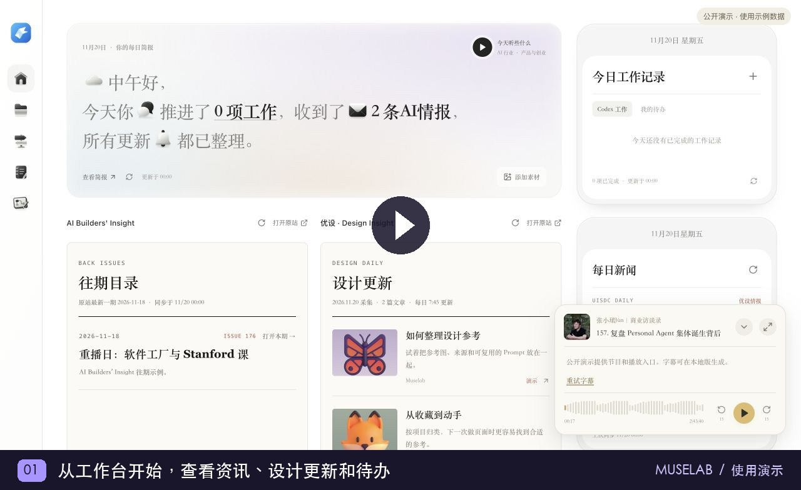
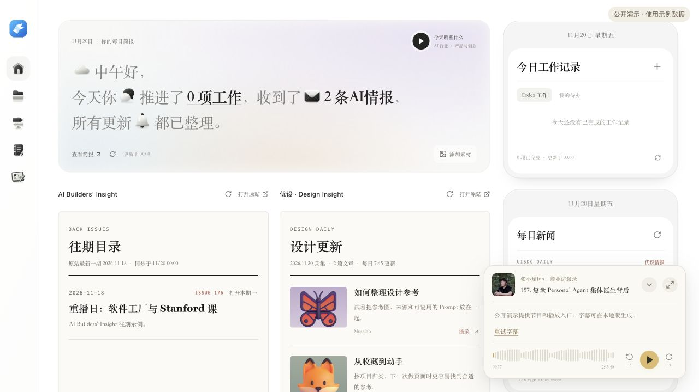
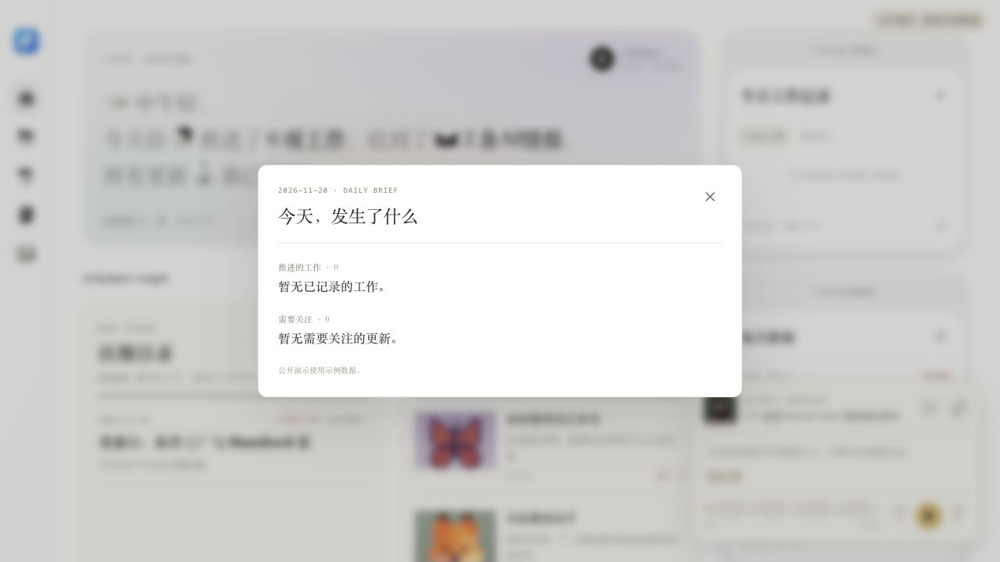
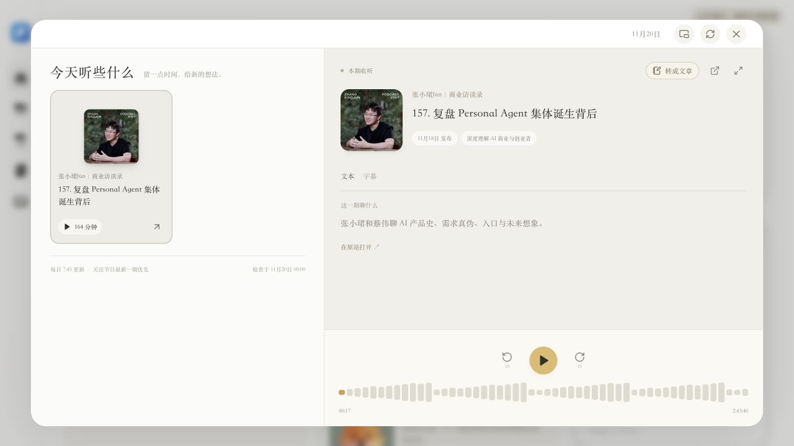
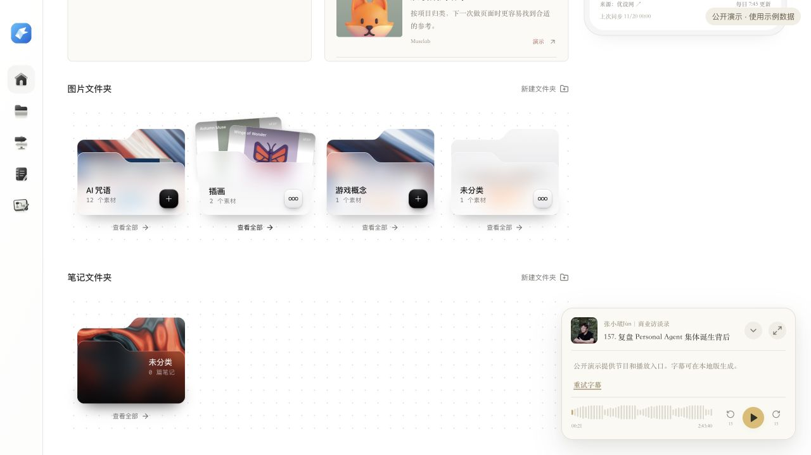

# Muselab · 个人工作台

资讯、播客和灵感图散在不同地方，存下来以后常常找不到。Muselab 是我用 Codex 做的个人工作台。我想每天打开同一个页面，看几条值得读的资讯，挑一期播客，再把有用的文字和参考图留到下次能找到的地方。

## 30 秒使用演示

[](https://cdn.jsdelivr.net/gh/LinglingZhangAI/muselab-workbench@main/docs/muselab-walkthrough.mp4)

从工作台打开每日简报，展开并播放播客，再切回小窗继续浏览插画素材。演示配有中文操作提示，可以静音观看。

[播放视频](https://cdn.jsdelivr.net/gh/LinglingZhangAI/muselab-workbench@main/docs/muselab-walkthrough.mp4) · [下载 MP4](https://github.com/LinglingZhangAI/muselab-workbench/raw/refs/heads/main/docs/muselab-walkthrough.mp4) · [在线体验](https://linglingzhangai.github.io/muselab-workbench/)

## 页面截图

| 工作台首页 | 每日简报 |
| --- | --- |
|  |  |
| **播客播放器** | **插画素材** |
|  |  |

## 一天里怎么用

- **先看简报。** 首页集中展示 AI 资讯、AI Builders’ Insight 和设计更新，保留采集日期和原文入口。本地可以汇总当天的 Codex 工作记录，从简报回到相关任务。
- **边听边记。** 右下角的小窗可以展开，也可以缩回首页继续听。支持给同一期节目保留播放位置。字幕生成和翻译需要在本机配置工具。
- **把参考图变成可用的素材。** 导入图片，按项目整理，保留来处。连接支持图片输入的模型后，可以生成一份写清布局、字体、配色和交互的 UI Prompt，下次把图和 Prompt 一起交给 Codex。
- **留下以后还会用的内容。** 笔记可以保留摘录的来源，白板适合摆放图片、整理关系或梳理思路。

## 在线体验

[打开 GitHub Pages 演示](https://linglingzhangai.github.io/muselab-workbench/)

演示用示例内容展示首页、图册、白板和播客小窗。播放依赖节目源站。笔记和编辑保存在当前浏览器。实时采集、生成字幕和连接模型需要运行本地版。

## 本地运行

需要 Node.js 22.20+ 和 npm。

```sh
npm ci
npm run dev
```

打开 <http://127.0.0.1:4187/>。首次读取公开资讯和播客时，需要连接源站。模型配置见 [AI 配置](AI-SETUP.md)，本地字幕见 [播客字幕指南](docs/podcast-subtitles.md)。

## 部署

仓库的 GitHub Actions 可以将示例站部署到 GitHub Pages。在仓库的 **Settings → Pages → Build and deployment** 里选择 **GitHub Actions**，然后运行 **Deploy GitHub Pages**。完整的 Node 服务与持久化配置见 [部署指南](DEPLOY.md)。

项目使用 React、TypeScript、Vite 和 Excalidraw。许可和演示图片来源见 [LICENSE](LICENSE) 与 [素材来源](ASSET-SOURCES.md)。
